<!-- Reading copy of five-hands.html, written by src/build_story.py. Edit report/story.template.html, not this file. -->

Beinecke MS 408 · a reconstruction, for filming

# Five Hands

How the Voynich manuscript may have come to exist, told in nine scenes and set up for a film.

**Hand 1** 27 of 52 sheets plants, jars · f88r

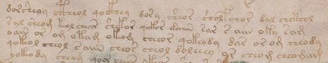

**Hand 2** 11 sheets baths, plants · f78v

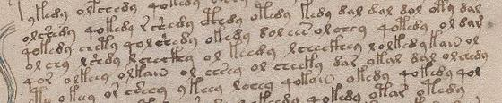

**Hand 3** 8 sheets starred paragraphs · f103r

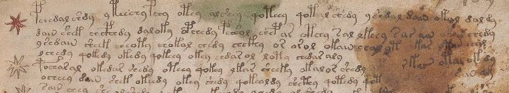

**Hand 4** 4 sheets zodiac, sky · f71r

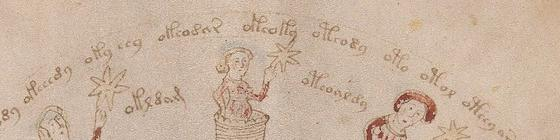

**Hand 5** 2 sheets plants · f48v

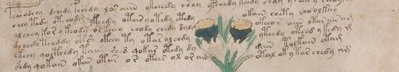

Somewhere in the German-speaking south, in the first decades of the fifteenth century, five people filled more than two hundred pages of calfskin with plants, stars, bathing women and 39,026 words that nobody has read. This is our best account of how and why.

## The account in brief

1. Between about 1404 and 1438 a healer who served women at a bath town wanted a book that looked like a physician's whole shelf and could not be checked.
2. A professional scribe invented an alphabet and a manner of writing word-like strings. He filled the plant and pharmacy pages one folded sheet at a time.
3. Four more scribes, taught the letters and the manner, added the zodiac, the baths and the pages that look like remedies. Their shared habits drifted away from his.
4. The loose sheets served as a prop of authority. They got wet, and were later sewn together by their pictures, in an order they had never had.
5. Every owner since has taken the book for what it was built to resemble.

### How far to trust this

35–40%

That is the working weight our analysis gives to this kind of explanation: a book made to look learned, with no message in its text. Two rivals hold most of the rest, so the account is more likely wrong than right in kind. It is certainly wrong in particulars, because the evidence names no town, no trade and no person. We chose each particular as the most ordinary way to satisfy the evidence.

Made to look learned · 35–40%

Real compendium, meaning lost in the making · 25–30%

Real compendium in a letter-level cipher · 20–25%

Invented language, or a plain unknown one · about 7%

The weights and the tests behind them are in the [dossier](https://claude.ai/artifact/RUmX9pVU2m24pmBDDEnWaM).

### Four marks

Beside each scene is a list of what it rests on. Every item carries one of these.

- **Documented.** A catalogue, a laboratory report, a letter or a published study says so. The notes in the repository record which we read at the source and which we took from a summary.
- **Measured.** We computed it from the transliteration or the page images. The code is in the repository.
- **Inferred.** A conclusion drawn from documented or measured facts. New evidence could overturn it.
- **Imagined.** Invented to make a scene. It suits the period and is tied to no evidence about this book.

## Nine scenes

The scenes are written in the present tense because they are staged. The makers have no names here. The record gives them none, and the film will show their hands.

### Scene 1 · Skins

A parchment maker's yard · between 1404 and 1438

The book begins as calves. Their skins lie in a pit of lime until the hair slips off. A man pegs each one wet onto a wooden frame and scrapes it with a blade curved like a new moon. As it dries under tension the hide turns into a pale sheet that rings when he flicks it. He rubs it down with pumice and chalk and cuts it into rectangles a little larger than two open hands.

Someone has ordered a great many of these. Folded once, each rectangle gives four pages about nine inches tall. The order also asks for longer pieces that will fold out two and three pages wide, and one piece six pages large. Added up, it is a small herd.

Paper would have done the job. A mill has been turning at Nuremberg since 1390, and the workshops along the Rhine that sell picture books in German write on paper. This buyer wants skin. Old books are made of skin, and this one has to look as though it has always been true.

#### What this rests on

- **Documented.** The University of Arizona dated four samples from different sheets in 2009: 1404 to 1438 at 95% probability. That dates the skins. It dates the writing only if the skins were used soon.
- **Documented.** The samples tested are calf. A page measures about 225 by 160 mm. One estimate in print is "at least fourteen or fifteen entire calfskins". We traced it to a book review and no further.
- **Documented.** Lime, frame, crescent knife and pumice are the common craft of the period. The Nuremberg mill of 1390 and the paper books of a Strasbourg workshop of about 1415 to 1425 are on record.
- **Inferred.** Skin was chosen for dignity. The book has no gold, its pigments are common and its drawing is untrained, so parchment is its one real expense.
- **Imagined.** The yard, the man, the order.

### Scene 2 · The buyer

A bath town in the German-speaking south · about 1420

Nothing in the book names a town. The staging needs one, so take a place that lives on hot water. In the spring of 1416 a papal secretary travelled from the church council at Constance to the baths at Baden and wrote down what he saw. There were about thirty pools. People leaned on galleries above the water and talked. The women bathed in linen shifts cut away at the neck and shoulders, and meals were served on tables that floated. Visitors came from two hundred miles away.

Our buyer makes a living in such a place from women who come for cures. The work is herbs, bleeding by the calendar, and advice on when to bathe and when to conceive. These are the common cures of the time and the buyer believes in them.

The buyer has also seen what a university physician carries. There is a herbal with a plant on every page. There is a calendar of the twelve signs with the rules for each. There is a book of the baths in which naked figures stand in every pool. These books are in Latin, they are costly, and every doctor has the same ones.

So the buyer decides to own a book that no rival can match and no patient can check. It will have every kind of page the real ones have. It will be written in letters that belong to no country. It does not have to say anything. It has to be opened at the right moment, in front of the right person, by someone who seems to be reading.

#### What this rests on

- **Documented.** Poggio Bracciolini's letter of 1416 describes Baden as given here. Nothing ties the manuscript to Baden. We borrow it because an eyewitness account of a southern bath town survives from these years.
- **Measured.** The surviving book has 129 plant pages, 16 of jars and roots, 12 zodiac wheels, 19 bathing scenes and 25 pages of star-marked paragraphs.
- **Documented.** Each kind of page has a known model: illustrated herbals, the German house books of medical astrology compiled from about 1400, and the Italian books of the baths.
- **Documented.** The marginal words are German: a colour note reading *rot*, and a charm that ends *so nim geismilch*. The zodiac archer holds a crossbow, as in German manuscripts of the century. Dress in the figures suits about 1400 to 1430. One castle has swallowtail battlements, an Italian form.
- **Inferred.** The makers worked in the German-speaking south and had seen Italian pictures. Nearly every figure is a woman, so the book's subject, real or pretended, is women's health. Brewer and Lewis argued in 2024 that it concerns women's medicine and conception.
- **Imagined.** The buyer, the trade and the motive. The historian Sergio Toresella proposed something close in the 1990s: a showpiece made to impress a healer's clients.

### Scene 3 · The hand

A writing room off the market · the same year

The buyer goes to a man who writes for money. He copies deeds and prayer books, and he teaches boys their letters. He hears what is wanted and thinks about labour.

He could take a real herbal and exchange every Latin letter for a secret sign. That is slow, it needs checking, and the customer could never tell that it had been done. Filling a page with marks that only look like words takes no longer than writing them.

So he makes an alphabet. He borrows shapes his hand already knows: the hooked sign that clerks use to shorten Latin words, a figure like a 4 from the new numerals, loops that run easily from a quill. He adds four tall letters that stand above the line the way capitals do in a charter.

Then he finds a rhythm. A word begins in one of a few ways and ends in one of a few ways. The next word is often the last one with something changed. A paragraph opens with a tall letter. A line opens with a stroke that announces it.

He tries a page. At arm's length it looks like a language. He almost never has to correct it, because there is nothing in it to get wrong.

#### What this rests on

- **Measured.** Knowing the previous word helps predict the next by 0.004 bits. In 25 real texts the least was 0.07, and ordinary prose gave about 0.43. A written word here does not behave like a word in a sentence.
- **Measured.** 311 words can be built from a short list of stock beginnings and endings. 253 of them occur, and they make up 44% of the running text.
- **Measured.** A word resembles the one before it 30% more often than chance allows. 85% of paragraphs open with one of the four tall letters. One letter starts 9.6% of lines and 0.5% of other words.
- **Measured.** The transliteration notes 26 corrections in 39,026 words. That is a floor. Nobody has yet counted them from the photographs.
- **Documented.** Students of the script have long matched several of its shapes to Latin abbreviation signs and to numerals. Volunteers asked to write meaningless text produce regularities of the same kinds (Gaskell and Bowern, 2022).
- **Inferred.** The scribe improvised from stock parts and had no text underneath. A cipher over real sentences would keep some of their word order, unless each written word stands for less than a word.
- **Imagined.** The man, his trade, and his reasoning about labour.

Words by their beginning and ending, counts in 34,863 words of running text

| begins / ends | -y | -dy | -edy | -eedy | -ey | -eey | -aiin | -ain | -ol | -or | -al | -ar | -am |
|---|---|---|---|---|---|---|---|---|---|---|---|---|---|
| (none) | 258 | 245 | · | 4 | 1 | 5 | 459 | 108 | 531 | 366 | 216 | 331 | 73 |
| qok- | 146 | 4 | 276 | 307 | 108 | 303 | 265 | 279 | 96 | 32 | 191 | 157 | 25 |
| ch- | 147 | 139 | 494 | 57 | 337 | 176 | 48 | 19 | 378 | 208 | 47 | 76 | 17 |
| d- | 245 | 2 | 2 | 4 | 1 | 6 | 817 | 211 | 105 | 66 | 214 | 286 | 84 |
| sh- | 94 | 43 | 424 | 82 | 269 | 144 | 20 | 9 | 179 | 95 | 15 | 30 | 6 |
| ok- | 91 | 1 | 109 | 105 | 55 | 159 | 204 | 136 | 64 | 29 | 134 | 123 | 29 |
| ot- | 103 | 2 | 140 | 90 | 43 | 108 | 141 | 94 | 65 | 32 | 125 | 126 | 45 |
| qot- | 86 | · | 87 | 76 | 23 | 41 | 79 | 60 | 44 | 26 | 59 | 63 | 11 |
| k- | 30 | · | 47 | 62 | 14 | 50 | 77 | 43 | 37 | 26 | 25 | 57 | 7 |

*Measure.* How often each beginning (rows) meets each ending (columns) in the running text. Brighter cells are commoner words. The commonest single word in the book is *daiin*, written 849 times. Point at a cell to see the word it makes.

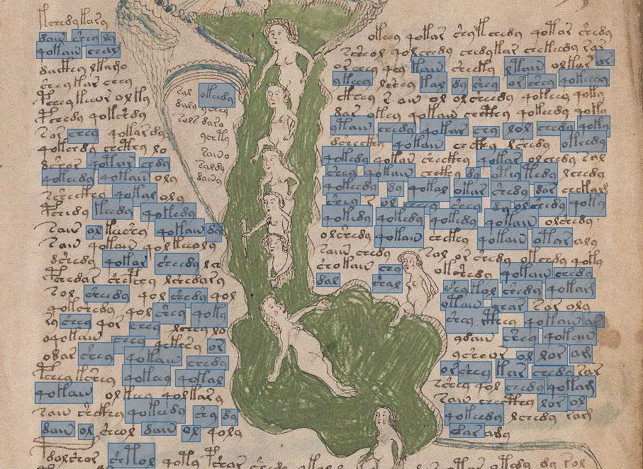

*Measure.* f75r, second hand. Tinted words are built from the stock beginnings and endings in the table: 117 of the 209 words in this frame.

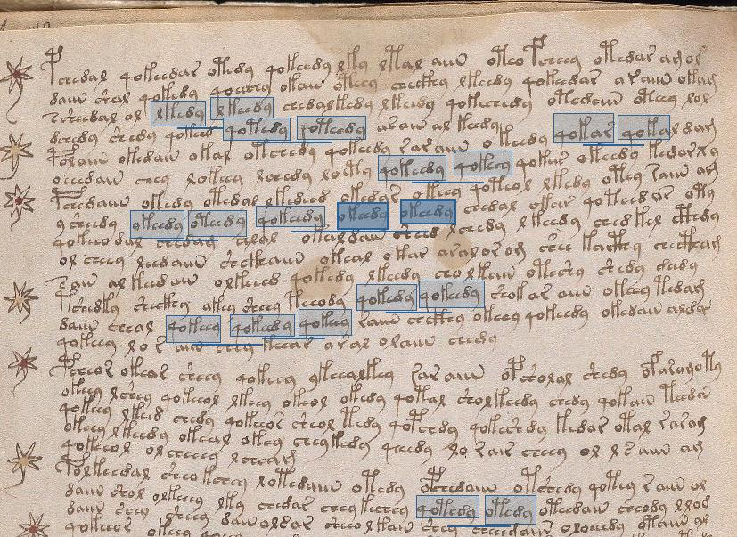

*Measure.* f108v, third hand. Boxed and joined: neighbours on a line that are identical (1) or one glyph apart (10), among 200 words in this frame.

### Scene 4 · The sheets

The same room · over a winter

He works one sheet at a time. A sheet is a rectangle of skin folded once, which makes four pages. He draws first, in the brown ink he writes with: a plant from root to flower, filling the page. Where a part should be red he leaves a small note for whoever will paint it, in his own language. The note says *rot*.

Then he writes around the drawing and breaks his lines wherever a leaf is in the way. He fills the first page, turns the leaf and fills the second. Now the sheet lies open with the second page beside the third. He fills the third with the second still in view. He turns the last leaf, fills the fourth, and reaches for the next sheet.

There are about ninety words on a page. Twenty-seven of his sheets survive, a hundred and thirteen pages. Most hold one plant each. Sixteen show jars and loose roots set out like an apothecary's shelf.

The plants look like herbs and match none exactly. A root from one sits under the leaves of another. Nobody at the baths will go looking for them in a field.

#### What this rests on

- **Measured.** Two pages on the same sheet share more vocabulary than two other pages by the same scribe in the same gathering. The excess is greatest for the pair that lies open together and falls with distance in writing order. Pages that face each other in the bound book but sit on different sheets show none.
- **Documented.** Layfield and Davis reported the sheet effect in 2026. We reproduced it from their paper, then added the scribe control and the fall-off.
- **Documented.** Ink analysis found text and drawings in the same kind of iron-gall ink, probably made together. Small colour notes in German, one reading *rot*, survive on pages by this hand.
- **Inferred.** Each sheet was filled in page order at one sitting, and what the scribe could see shaped what he wrote next.
- **Imagined.** The winter. That the plants are assembled from parts is our staging. Some scholars name real species for some of them.

**** **** The two pages that lie open together · +0.155

**** **** Two sides of one leaf · +0.107

**** **** One page apart on the sheet · +0.077

**** **** The first and last pages of the sheet · +0.066

**** **** Facing pages that sit on different sheets · −0.001

*Measure.* How much more alike two pages are when they share a sheet, set against other pages by the same scribe in the same gathering. The four boxes are the four pages of a folded sheet in writing order. Nine gatherings, latent semantic similarity.

### Scene 5 · Four more

The same room · later

The buyer comes back for the rest: the calendar, the baths, the remedies. The writing master has other work. He sets four of his people to it and shows them the letters and the manner. He cannot give them a list of words, because there is none.

They sit together and their habits grow together. A pair of letters their master almost never joins turns up in one of their words out of every five. Scholars will one day call his manner Language A and theirs Language B, and ask which tongues these were.

The second hand takes the baths. Small naked women stand in green pools joined by pipes. On one sheet a pipe leaves a pool on the right-hand page, crosses the fold and empties into a pool on the left. The picture joins up only when that sheet lies open by itself.

The third hand takes the remedies, or what stands in for them: nearly three hundred short paragraphs, each with a star in the margin. The fourth hand takes the sky. Around each sign of the zodiac it sets thirty women in rings, each holding a star, with a word beside her. The Ram and the Bull get fifteen and fifteen across two pages each. The fifth hand writes seven pages and stops.

Twice their work meets on one sheet. On a page of the remedies the second hand writes the first twelve lines and the third hand writes the rest. On the largest sheet in the book, six pages large when unfolded, the fourth hand fills one side with nine linked circles and a small castle with notched Italian battlements, and the second hand fills the panels on the back.

Two of them draw the same plant on different sheets. The words beside one are no closer to the words beside the other than any two pages are.

#### What this rests on

- **Documented.** Lisa Fagin Davis distinguished five scribes in 2020. Her attributions are recorded page by page in the transliteration we used, including the page and the foldout where two hands meet.
- **Measured.** The letter pair *ed* occurs in 20.6% of words in Language B and 0.3% in Language A. Changing the scribe changes the vocabulary more than changing the subject does.
- **Measured.** 292 starred paragraphs. 299 labelled figures on the twelve surviving zodiac pages. 58% of labels begin with the same letter, against 22% of words in running text.
- **Measured.** The interlinear file of 1998 records the plant on f39r as drawn again on f95r2. Their texts rank at the 56th percentile of likeness among comparable pairs: ordinary. One pair proves little.
- **Inferred.** The four later scribes learned together and worked side by side. Thirty figures to a sign suggests one for each degree or day.
- **Imagined.** That the first hand came first and taught the rest. The record does not say which manner is older. We stage A first because it is the plainer system and its pages carry the notes to a painter.

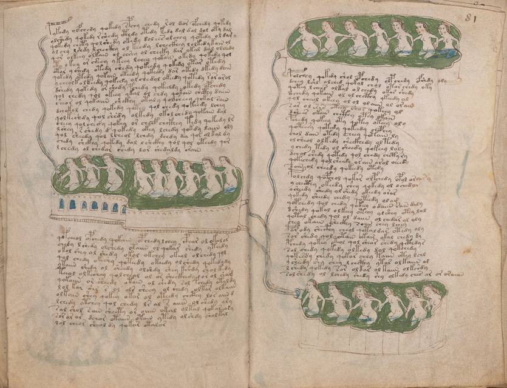

*Object.* f78v and f81r laid side by side, as the inside of one folded sheet. The pipe from the pool at upper right crosses the fold to the pool at left. In the bound book four other pages lie between them.

### Scene 6 · In use

The bath town · the years after

The sheets go to the buyer loose, a stack of folded skins. For a while that is how the book lives.

Stage one consultation. A woman has come to the baths because she has been married four years and has no child. The healer asks the month of her birth, turns to the sheet for that sign, and lays a finger on one of the thirty women. Then the sheet of the baths. Then a plant. The healer's lips move.

The patient cannot read, and it would not help her if she could. What she can see is that the answer to her trouble is written down, that the book is strange and old, and that this person can read it. She will do as she is told, and she will pay.

Something like belief grows on the healer's side of the table too. On the back of the last sheet someone writes out a charm, part in garbled Latin and part in the German they speak. Crosses divide its words. Its last line opens with two words in the book's own letters and closes with an instruction to take goat's milk. The charms of the time are full of words nobody understands. The book's words have joined them.

Then water gets at the stack. It soaks through the first sheets and leaves a tide line that is still there.

#### What this rests on

- **Documented.** The last page, f116v, carries a few lines in a Gothic hand of the first half of the fifteenth century. The first word is usually read *poxleber* and the last line ends *so nim geismilch*. Two words in that line are in the book's script.
- **Documented.** Davis finds the same hand in a note at the top of f17r, and finds that it was written before the water stain. The stain covers the first seven gatherings and came before the book was bound.
- **Inferred.** Someone who spoke German and could write the book's letters had the sheets while they were still loose. That is a maker or a first owner. The crosses and rhyming words mark the lines as a charm.
- **Imagined.** The consultation, the patient and her trouble, and the healer's half-belief.

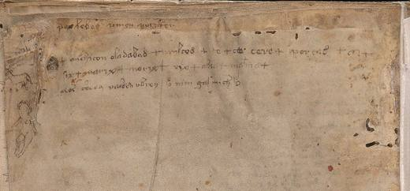

*Object.* The top of f116v. Crosses divide the words of the middle lines. The last line begins in the book's script and ends in German.

### Scene 7 · The binding

A binder's bench · before 1500

At some point the stack becomes a book. Whoever sews it cannot read it and has no way to tell which sheet should follow which. They sort by pictures. Plants go with plants, the master's sheets mixed among his pupils'. The bathing sheets are slipped one inside another like the leaves of any gathering. The pipe that crossed an open sheet now runs into the gutter and comes out four pages later.

A different pen numbers the gatherings in the corner. The book is sewn on three cords between wooden boards. From now on it has an order, and people will try to read it in that order for six hundred years.

#### What this rests on

- **Documented.** Davis: scribes alternate sheet by sheet inside the gatherings, the first binding was already a misbinding, and the stain came before it. Zandbergen and Pelling dispute parts of her reading.
- **Documented.** The gathering numbers are fifteenth-century and in an ink unlike the text ink. There were three sewing supports and once wooden boards.
- **Measured.** A new order for the bathing sheets has been proposed from the text. The same search run on scrambled data does as well or better 56% of the time. The text shows that each sheet is a unit. It does not show an order among sheets.
- **Inferred.** The binder sorted by picture because the text gave nothing to sort by. If the text were readable, a binder who could read would have kept its order.
- **Imagined.** The bench and the binder.

*[Diagram. Left: five folded sheets standing side by side, each written on its own. Right: the same five sheets nested one inside another as they are bound. Sheet 78 and 81 is highlighted. When nested, leaves 79 and 80 lie between its two halves.]*

*Measure.* The bathing gathering seen from its top edge. Each V is one folded sheet, labelled by its two leaves.

### Scene 8 · Other owners

France or Catalonia, Prague, Rome, New Haven · to 1969

The book outlives the people who knew what it was. That may take one generation.

Its next reader takes it at its word. Someone who writes a French or Catalan sort of dialect goes through the zodiac and writes a month beside each sign: March by the Fish, April by the Ram. It is the first record of a person trying to read the book, and it is a sensible reading. The pictures were built to invite it.

After that the trail is empty for a century and a half. In 1599 the accounts of the emperor Rudolf II record six hundred florins paid to an Augsburg physician for a small barrel of strange books. Sixty-six years later a Prague physician reports hearing that the emperor paid six hundred ducats for this one and thought it the work of Roger Bacon. The sums match and the coins do not. The record comes no closer than that.

Some time after 1608 the emperor's distiller writes his name on the first page. By 1639 the book belongs to Georg Baresch, a Prague alchemist, who writes about it to Athanasius Kircher in Rome, the Jesuit scholar who claims to read the writing of Egypt. It has been taking up space uselessly in his library, he says. From the herbs and stars he guesses the whole is medical. He adds that an author would hardly have gone to such trouble to hide commonplace things.

In 1665 the book is sent to Kircher. It passes into Jesuit libraries. In 1873 it is kept back from confiscation under the label of the Jesuit general's private library. In 1911 or 1912 it is sold quietly to a bookseller named Wilfrid Voynich. In 1969 it reaches Yale.

Each of these owners does what the patient at the baths did. They see a book of knowledge, and they cannot read it.

#### What this rests on

- **Documented.** The month names are in a later hand and a Romance dialect. Readers have called it northern French, Occitan and Catalan.
- **Documented.** Guzy found the 1599 payment to Carl Widemann in 2022. It names no book. The 600 ducats come from Marci's letter of 1665, reporting what a man who died in 1644 had told him.
- **Documented.** The name of Jacobus de Tepenec on f1r was scraped away and shows under ultraviolet light. He used that form of it after 1608 and died in 1622.
- **Documented.** Baresch to Kircher, Prague, 27 April 1639, in our translation from the Latin: the writing *inutiliter occupasset locum*; *conjicio totum esse medicinalem*; *causa plebeiorum occultandorum, tali industria vix author usus fuisset*.
- **Inferred.** The book reached a Romance-speaking owner before it reached Prague. Baresch's reasoning is the reasoning the book was built to produce.

1. **1404–1438** The calves are killed. The sheets are probably written within a generation.
2. **before 1500** A German charm is added while the sheets are loose. Water stains them. They are sewn and the gatherings numbered. A Romance hand adds months to the zodiac.
3. **c. 1500–1599** No record.
4. **1599** Rudolf II pays 600 florins to Carl Widemann of Augsburg for a small barrel of strange books. A possible way in.
5. **after 1608** Jacobus de Tepenec, imperial distiller, signs the first page.
6. **1637–1639** Georg Baresch sends samples and then a letter to Athanasius Kircher.
7. **1665** Johannes Marcus Marci sends the book to Kircher with the story of the emperor and Roger Bacon, and adds that he suspends judgement.
8. **1873** Kept back from the confiscation of the Jesuit library in Rome.
9. **1911 or 1912** Wilfrid Voynich buys it from the Jesuits under a promise of secrecy.
10. **1961, 1969** H. P. Kraus buys it for $24,500, fails to sell it for $160,000, and gives it to the Beinecke Library at Yale.

*Archive.* Custody, from the records summarised in the dossier.

### Scene 9 · What it is, if this is right

A reading room · now

If this account is right, the manuscript is a portrait of a learned book. Its makers knew such books from the outside. They knew how a herbal fills a page, how a calendar rings a sign with figures, how a paragraph begins. They copied all of that faithfully and left out the one part their customer could not see.

It would also be the most sustained imitation of writing that survives from the Middle Ages. Painters of the time put scribbled letters on the hems of robes and on the pages of painted books. Those run for a line or two. This runs for two hundred pages in five hands, and it has held its own against an emperor's court, the most learned Jesuit of his age and the code-breakers of two world wars.

And the book would have no secret. Its makers would have one, and it is an ordinary one. They were paid, they were good at the work, and the work did what it was made to do.

#### What this rests on

- **Measured.** The next letter is far easier to guess than in any real text we tried: 2.07 bits against 3.08–3.48 in 15 languages. No published cipher or generator yet matches all of the book's numbers. The best generator repeats itself 2 to 12 times too much.
- **Documented.** Pseudo-script on painted cloth and painted pages is common in European art of these centuries. No second person has reproduced any proposed reading of this book in over a hundred years of attempts.
- **Inferred.** All of scene 9. It follows only if the account does.

## How it could be wrong

A reconstruction earns trust by saying what would sink it. Three things would, and two rival tellings fit most of the same evidence.

### The same evidence, read as preservation

Davis reads the five hands as a community writing down knowledge it valued, perhaps women's folk medicine, and adds that this cannot yet be proved. On that reading a sheet is a unit because each sheet holds one piece of text, and the two manners are two habits of one writing system. Our scenes 1, 4, 5, 7 and 8 survive almost unchanged. Scenes 2, 3 and 6 do not.

### The same evidence, read as cipher

If each written word stands for a letter or two, the absence of word order is expected and the book is a short real text of about ten thousand words. Naibbe, a cipher of that kind built in 2025, reproduces the look of the text. It does not reproduce the echo between neighbours or the marked line starts, and nothing so elaborate is documented from those decades.

### What our own telling still owes

A working model. The published generator of meaningless text matches the manuscript in kind and overshoots in amount. Until some procedure a scribe could follow lands on the book's numbers, this account explains the text only in outline. It also has to explain why vocabulary shifts with subject within one scribe's pages.

| If this turned up | It would mean | And the account would |
|---|---|---|
| Eye-skips and repeated lines of the kind a copyist makes from an exemplar, counted from the photographs | The scribes were copying a text that existed before the page did. | Lose scene 3. The meaning-lost and cipher tellings would rise. |
| Rare words that follow a plant from its herbal page to the pharmacy pages, across scribes | The text refers to the pictures. | Fail. Something is being named. |
| A decoding rule that a second person can run on pages they have not seen and get sense | There is a message. | Fail outright. |
| Stains, offsets or sewing holes showing the sheets were written or kept in the bound order | The single-sheet model is wrong. | Lose scenes 4 and 7 as told. |
| A scribe-followable routine that hits the book's three prediction numbers and its line starts | Meaningless text of this exact kind is producible. | Gain its missing piece. |
| Protein or DNA matching these skins to a dated, placed manuscript | A region, perhaps a workshop. | Trade its imagined town for a real one. |

### Other stagings inside the same account

- The five hands could be a household and its apprentices, or a small religious community, in place of a writing master and his pupils.
- The purpose could be sale to a collector in place of use with patients. The charm on the last page argues for use.
- The place could be anywhere from Alsace to the Tyrol or the Veneto. We set it at a bath town because the pictures dwell on bathing.
- The makers could have half-believed the letters held power. Then this account shades into the invented-language telling.

## For the documentarian

Five Hands is a film about how a book was made, told through the hands that made it. No face is ever in focus. The audience learns one rule in the first minute: the film always tells them which kind of picture they are looking at.

### Three kinds of picture

They follow the four marks. Inference has no picture of its own. It lives in the narration.

- *Object.* The manuscript itself, from the Beinecke Library's public-domain photographs. It is never retouched, recoloured or animated. The folio number sits in the lower corner of every shot.
- *Measure.* Marks drawn over the object in one colour, the blue of the book's own azurite: counts, highlighted letters, lines joining pages. Every number on screen is one the repository reproduces.
- *Workshop.* Reconstruction: hands, tools, rooms, weather. A small ring in the corner marks it. No legible page appears in a reconstruction shot. When the film needs to show writing, it cuts to the object.

The narration keeps the same rule by tense. It uses the past tense for what is documented or measured, the present for what is staged, and *would* or *may* for what is inferred. A viewer who shuts their eyes can still tell the registers apart.

### The world, as far as the record gives it

**When**

Skins of 1404 to 1438. Dress in the figures favours 1400 to 1430. Stage it about 1420.

**Where**

Unknown. German marginal words, a crossbow archer of the German kind and Italian battlements point to the German-speaking south with a view over the Alps. Stage a bath town on the Swiss plateau or the upper Rhine, and say on screen that the town is chosen.

**The baths**

From Poggio's letter about Baden, 1416: about thirty pools, public and private. A fence between men and women in the public ones. Galleries above for onlookers. Men in leather aprons. Women in knee-length linen shifts open at neck, shoulders and arms. Floating tables, music, visitors from two hundred miles off. The bathers in the book are naked, many in headdresses, as in the Italian bath books.

**The writing room**

A sloped desk at a window. Goose quill, penknife, ink horn, pumice, a lead weight on a cord to hold the sheet. Iron-gall ink goes on pale and darkens to brown-black over hours as it meets the air. Writing is done by daylight.

**Paint**

From the 2009 analysis: blue of ground azurite, a copper green, red-brown ochre, white of chalk in egg glair, gum as binder. In the scans it lies in thin washes, often over the lines.

**Dress**

Full sleeves gathered at the wrist, hoods, veils and rolled headdresses of the first third of the century. Undyed wool and linen for working people. Nothing later than about 1430.

**The models**

A herbal with one plant to a page. A German house book of medical astrology with its calendar and signs. An Italian book of the baths. Props may show these closed or at a distance.

**Speech**

An Upper German dialect, heard only as murmur. Latin belongs to the real books. Nobody in the film speaks a line.

### Colour, sampled from the pages

Reconstruction scenes are graded to this card. The only saturated colours on screen are the ones in the book.

- **Parchment** #c8b4a1
- **Parchment, shade** #a79078
- **Iron-gall ink** #57412f
- **Ink, faded** #7a624c
- **Azurite** #425868
- **Copper green** #557e67
- **Leaf green** #64714d
- **Red ochre** #a35847
- **Yellow ochre** #93714f

### Frame, lens, light, sound

**Frame**

1.37 to 1. An open sheet of this book is about 320 by 225 mm, a ratio of 1.42, so one sheet fills the frame with a thin border. Deliver pillarboxed inside 16 by 9.

**Lenses**

A 100 mm macro for pen, ink and pigment. A 50 mm for desk and hands. A 28 mm for rooms, used rarely. Object shots on a copy stand with the sensor parallel to the page.

**Light**

Writing happens in soft north light from the scribe's left, so the hand's shadow falls away from the line. Night belongs to the baths and the consultation: tallow and rushlight, low and warm, faces lost. The object is lit flat and even at daylight balance.

**Movement**

The camera moves the way reading does. Along a line at the pace of a finger. Down a page. A slow push to one word. In the workshop it sits on sticks or a slider at desk height. The one overhead shot is the folding of a sheet.

**Speed**

24 frames a second. Ink macro at 48. One time-lapse: a stroke darkening.

**Sound**

The quill is the score: its scratch on skin, the tap on the horn, the knife. Water for the baths. Music enters late and stays thin, one bowed and one plucked instrument. No drones, no choir, nothing that signals mystery.

**Voice**

One narrator, unhurried. No dialogue and no experts on camera. Sources appear as a line of text when a document is on screen.

### Shape

About twenty-six minutes. It also cuts into seven short chapters.

1. **0:00** **Cold open** The object. Five strips of writing. What we counted. The hinge into reconstruction, then the title.
2. **1:30** **Skins** Scene 1. Lime, frame, knife. The radiocarbon dates over the cut sheets.
3. **4:00** **The hand** Scenes 2 and 3. The buyer and the real books. The alphabet. The word grid assembles over a line of text. The line where word order should be, and is not.
4. **10:00** **Sheets** Scenes 4 and 5. The fold, filmed from above. Four more hands. The pipe that crosses the fold.
5. **16:00** **In use** Scenes 6 and 7. The baths at night. A finger on a painted figure. The charm. Water. Needle and cord.
6. **21:00** **Other owners** Scene 8. The months in another hand. Prague. Baresch's letter read over the pages he describes.
7. **24:30** **What would change our mind** Scene 9, then the list of findings that would sink this account. The film ends on the list.

### Storyboard

Eighteen frames at the film's ratio. Object frames are cut from the real pages. Workshop frames are described and wait to be shot or generated.

1. 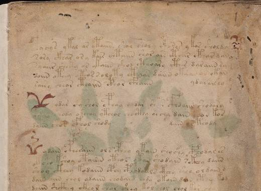

   01 Object · f1r

   The first page, worn pale. Slow push. Somewhere on it a scraped name shows only under ultraviolet.

   copy stand · push in · room tone
2. A calfskin laced to a frame. The curved knife comes down it.

   02 Workshop · skins

   Shavings fall. The skin drums under the blade. Cut to a flick of a finger and the ring of a dry sheet.

   50 mm, then 100 mm macro · overcast yard
3. A sloped desk at a north window. Two hands and a quill.

   03 Workshop · the writing room

   We see hands, sleeves, the edge of a hood. The face stays above the frame. The sheet is blank.

   50 mm · sticks at desk height · window light from the left
4. One wet stroke of ink, grey, turning brown.

   04 Workshop · ink

   A single curved stroke on bare skin. The bead of ink sinks and darkens as it dries.

   100 mm macro · 48 fps, then time-lapse · quill scratch
5. 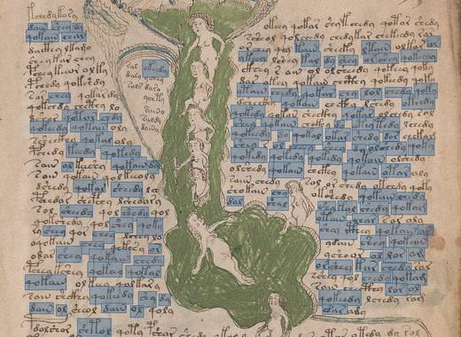

   05 Object, then measure · f75r

   The page as it is. Then, in blue, every word built from the same few beginnings and endings lights up, line by line, and the grid assembles beside them.

   locked off · tint draws on at reading pace
6. From above: a rectangle of skin is folded once and opened.

   06 Workshop · the fold

   Four dissolves. Page one fills, the leaf turns, page two fills, the sheet opens, pages two and three lie side by side.

   overhead · locked off · the only top shot in the film
7. 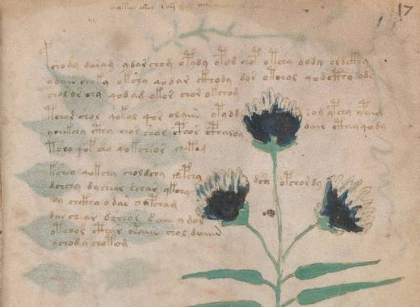

   07 Object · f17r

   A plant page. Text breaks where the leaves are. Tilt up to the faint note in the top margin, written by the hand of the last page.

   tilt up · quill fades out
8. 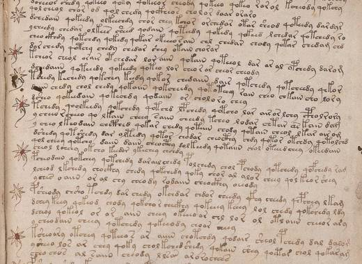

   08 Object, then measure · f115r

   Twelve lines in one hand, then another takes over. A blue rule marks the change. Two people sat at this page.

   push to line 12 · rule draws on
9. 

   09 Object · f78v with f81r

   The two pages slide together as one sheet. The pipe joins. Then the gathering is nested around them and they part.

   two stills on one stand · the nesting diagram follows
10. 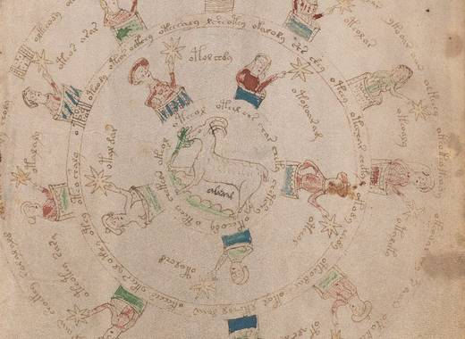

    10 Object · f71r

    The Ram and his fifteen women. Push to one figure, her star and the word beside her.

    push in · count appears: 30 to a sign
11. 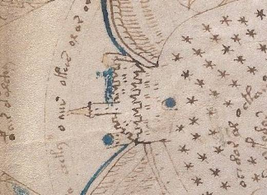

    11 Object · the six-page foldout

    A castle the size of a thumbnail. Its battlements are notched in the Italian way. Somebody here had seen the south.

    extreme push · hold
12. Night. Steam, a timber gallery, linen in warm light.

    12 Workshop · the baths

    Backs and shoulders in the water, a table afloat, onlookers leaning above. Built from Poggio's letter, and titled so.

    28 mm · rushlight · water and murmur
13. A finger rests on a painted figure. Across the table, a woman's folded hands.

    13 Workshop · the consultation

    The page is out of focus. The focus is on the two pairs of hands and the space between them.

    50 mm · one tallow dip · near silence
14. 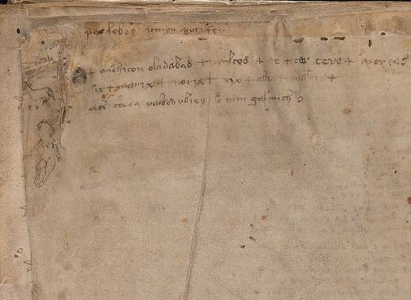

    14 Object, then measure · f116v

    Track along the charm. Blue picks out the crosses, then the two words in the book's letters, then *so nim geismilch*.

    lateral track · translation as subtitle
15. Water creeps under a stack of folded sheets. Later, a needle passes through the fold.

    15 Workshop · stain and thread

    Two macro shots joined by a dissolve. The tide line on the real pages follows.

    100 mm macro · drip, then thread through skin
16. 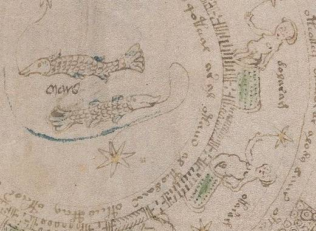

    16 Object · f70v2

    The Fish, and beside them one word in another hand and another language: *mars*. The first reader.

    push in · a different pen sound
17. Prague, 1639. A page of a letter in Latin.

    17 Archive · Baresch to Kircher

    The letter itself, by licence from the Gregorian University archive. His sentence about commonplace things is read over the plant pages.

    copy stand · quote on screen with its shelfmark
18. 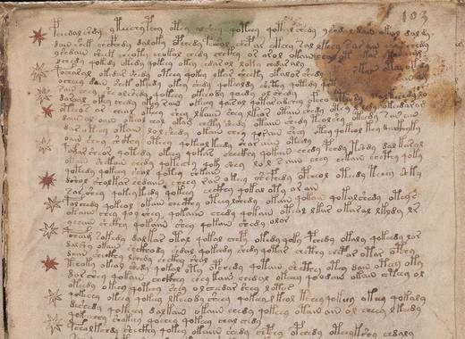

    18 Object · f103r

    The starred paragraphs. Pull back until the whole page is in frame. The list of what would change our mind runs beside it.

    pull back · quill returns · cut to black

### Narration, first ninety seconds

A draft, to show the tense rule working.

*Object.* f1r, slow push

This book was written about six hundred years ago, on the skins of calves. It is kept at Yale. Nobody has read it.

*Object.* five strips of writing, one above another

Five people wrote it. A palaeographer told them apart in 2020 by the way each one made the same letters.

*Measure.* counts rise over a line of text

It holds about thirty-nine thousand words. We counted what they do. Their order carried almost no information. In every real text we tried it carried at least five times more, and in ordinary prose about a hundred times more.

*Workshop.* a desk, a window, two hands

So try this. A man sits down at a window. He has been paid to make a book that looks like knowledge.

Five Hands

### Stills

| Plate | What it shows | Made from |
|---|---|---|
| Five hands | One strip of writing per scribe, stacked. The opening image of this page. | f88r, f78v, f103r, f71r, f48v |
| The word grid | Beginnings against endings, with counts. | The transliteration, computed |
| Stock parts on a page | Every word built from the grid, tinted on the photograph. | f75r, word positions, computed |
| Echo on a page | Neighbouring words that repeat or differ by one glyph, joined. | f108v, word positions, computed |
| The open sheet | f78v and f81r as one surface, the pipe crossing the fold. | Two page photographs |
| Written and bound | Five sheets side by side, then nested. | The collation, drawn |
| Likeness within a sheet | Four page pairs and the facing pages that share no sheet. | Computed, nine gatherings |
| The charm | The top of f116v with crosses, script words and the German line picked out. | One page photograph |
| Custody | The owners and the silent century and a half. | The records |
| Colour card | Nine colours sampled from the pages. | Page photographs, computed |

### House rules

Always

- Put the folio number on every object shot and the ring on every reconstruction.
- Cut to the real page whenever writing has to be legible.
- Say *may*, *would* or *we stage* whenever the narration leaves the record.
- Keep hands, tools and cloth plain: wool, linen, oak, horn, iron.
- Give the rival readings their minute, in their own strongest form.
- End on what would change the account.

Never

- Call the book decoded, solved or translated.
- Show a face as a named maker, or name the town as fact.
- Invent a legible page, or animate, recolour or restore a real one.
- Bring in Roger Bacon, Leonardo, John Dee or plants from the Americas as live options. The skins are too late for the first and, with the dress and the handwriting, too early for the rest.
- Place the 1912 purchase at the Villa Mondragone. The books had been hidden at Castel Gandolfo.
- Present the 600 ducats as a recorded sale. It is hearsay set down half a century later.
- Use cowls, cloisters or chant. Nothing puts the makers in a monastery.
- Light a writing scene with candles, or score any scene for mystery.

Briefs for the eight reconstruction frames

**House style, added to every brief.** Photographic, natural light, 35 mm film grain, 1.37:1 frame. Southern Germany about 1420. Muted palette of undyed wool, linen, oak and limewash; the only saturated colours are azurite blue, copper green and red ochre in small amounts. Hands and tools in focus, faces out of frame or out of focus. No legible writing anywhere. No candles in daytime scenes. No monks, no armour, no stained glass, no gold. A small open ring is added in the lower right corner in the edit.

**02 Skins.** Overcast yard. A pale calfskin laced with cords to a rectangular wooden frame leaning against a wall. A man's forearms and a crescent-shaped steel knife scraping downward; curls of shaving on the blade. Lime pit and wet hides soft in the background. 50 mm, eye level.

**03 The writing room.** Interior, day. A sloped oak desk under a small north-facing window with thick greenish panes. Two hands in loose wool sleeves gathered at the wrist: the right holds a goose quill, the left a small knife pinning a blank sheet of parchment. Cow-horn inkwell set in the desk. Soft light from the left. 50 mm, camera at desk height, face above the frame.

**04 Ink.** Extreme close view of bare cream parchment with visible grain and follicle marks. The split nib of a quill has just drawn one curved stroke; the ink is wet, pale grey-brown, pooled at the end of the stroke. Shallow focus, raking window light. 100 mm macro.

**06 The fold.** Directly overhead. A rectangle of parchment about 32 by 22 cm on a dark oak table; two hands fold it once along the short axis. Quill, knife, pumice stone and horn inkwell at the edge of frame. Even north light, no shadows across the sheet. Locked-off top shot.

**12 The baths.** Interior, night. A timber bath hall with a rectangular stone pool of steaming water. Bathers seen from behind in the water, women in knee-length linen shifts open at the shoulders, hair bound in cloth. A wooden board floats with bread and cups. A gallery with a rail above, figures leaning on it in silhouette. Light from rush lamps and one brazier; deep shadow. 28 mm, low angle across the water.

**13 The consultation.** Interior, night. A small table. One hand rests an index finger on an open sheet of parchment that is soft and out of focus, showing only blurred colour. Across the table a woman's hands are folded on plain wool. A single tallow dip in an iron holder. 50 mm, shallow focus on the fingertip.

**15 Stain and thread.** Two frames. First: clear water spreading under the corner of a stack of folded cream parchment sheets on a wooden shelf, the edge darkening. Second: a bone needle drawing linen thread through the fold of nested parchment sheets over a hemp cord on a sewing frame. 100 mm macro, daylight.

**17 The letter.** Not generated. Photograph of the original, Rome, Gregorian University archive, APUG 557, folio 353, by licence.

## Sources

Every measured number on this page is produced by the code in the repository and explained, with its controls, in the [dossier](https://claude.ai/artifact/RUmX9pVU2m24pmBDDEnWaM). The documented items were read at the sources below.

- Page photographs: Beinecke Rare Book and Manuscript Library, Yale University, MS 408. Public domain.
- Transliteration: Zandbergen and Landini, version 3b, with Davis's scribe attributions; Takahashi; Glen Claston's v101; the 1998 interlinear file.
- Word positions on the page: The Voynichese Project, 2014, as fitted to Yale's photographs by the Voynich Viewer project.
- René Zandbergen, voynich.nu: radiocarbon, materials, history, letters, marginal writing, illustrations.
- McCrone Associates, report on inks and pigments, 2009.
- Lisa Fagin Davis, "How Many Glyphs and How Many Scribes?", *Manuscript Studies* 5, 2020; "Voynich Codicology", 2025; lecture, Toronto, September 2025.
- Colin Layfield and Lisa Fagin Davis, on latent semantic analysis and the order of sheets, 2026.
- Stefan Guzy, "Book Transactions of Emperor Rudolf II, 1576–1612", 2022.
- Keagan Brewer and Michelle Lewis, *Social History of Medicine* 37, 2024.
- Daniel Gaskell and Claire Bowern, on gibberish written by volunteers, 2022. Torsten Timm and Andreas Schinner, *Cryptologia* 44, 2020. Michael Greshko, the Naibbe cipher, *Cryptologia*, 2025.
- Georg Baresch to Athanasius Kircher, Prague, 27 April 1639. Latin text as transcribed by Philip Neal from APUG 557, f. 353.
- Poggio Bracciolini to Niccolò Niccoli, Baden, 1416, in the translation of Phyllis Gordan.
- Handschriftencensus, entry for the iatromathematical house book. Studies of the Strasbourg workshop of 1418 and of Diebold Lauber.
- Sergio Toresella on the alchemical herbals, as reported by Zandbergen.

A reconstruction made with an AI system under one person's direction. It has not been reviewed by specialists. It reads nothing in the manuscript and should not be cited as a solution.

Built by src/build_story.py from report/story.template.html and the result tables.
